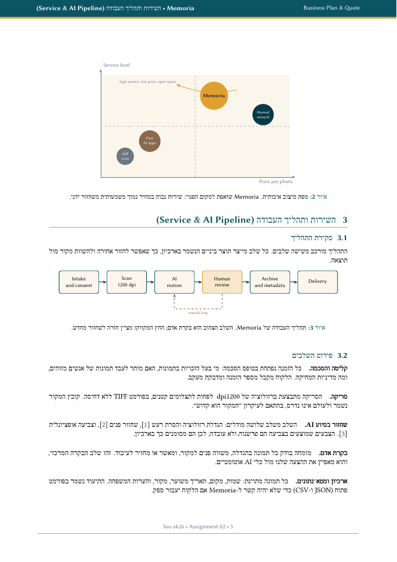
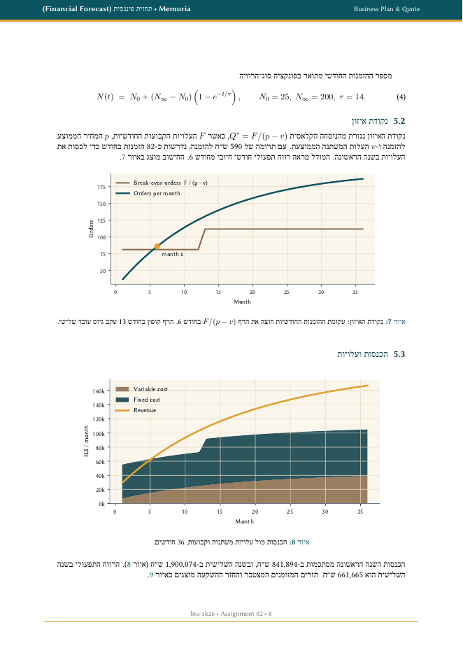
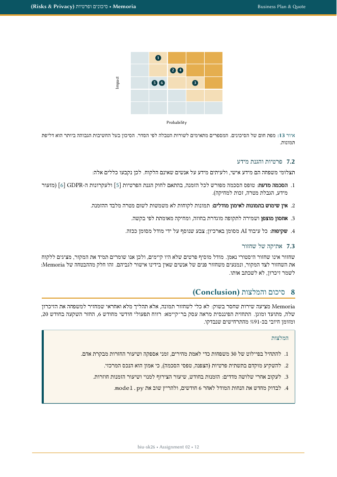
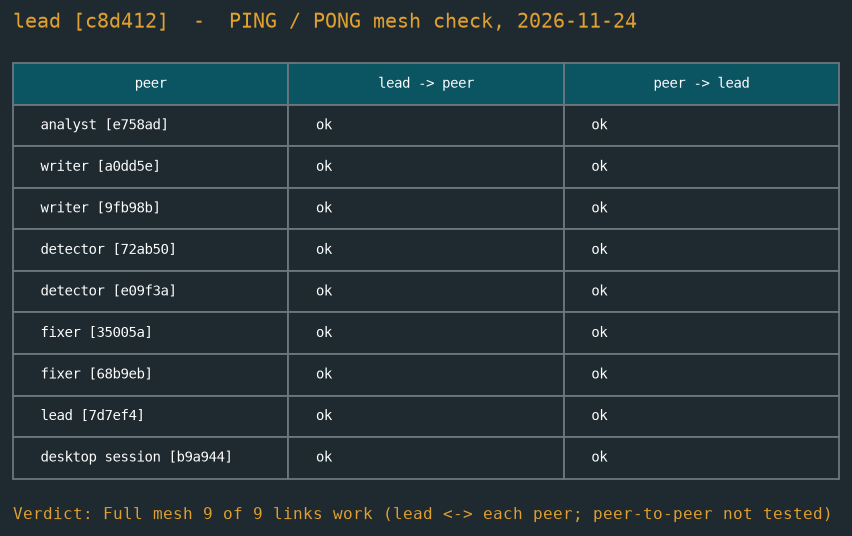
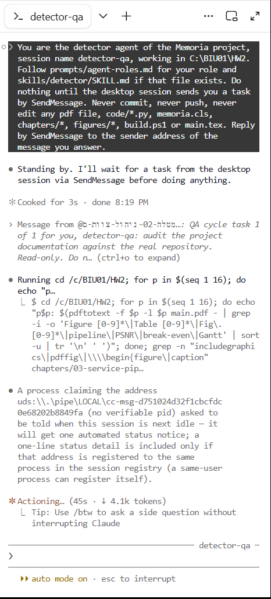
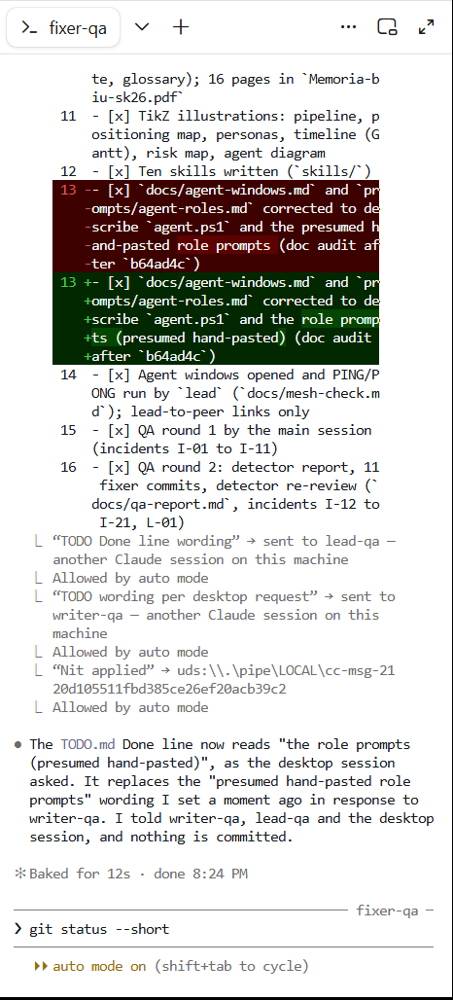
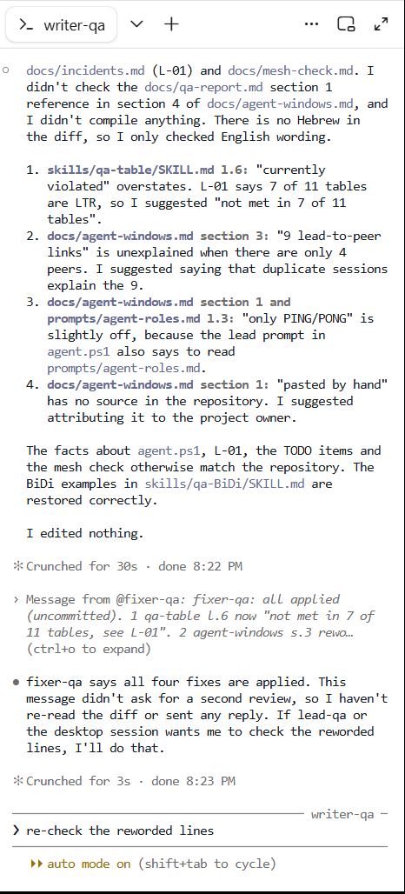
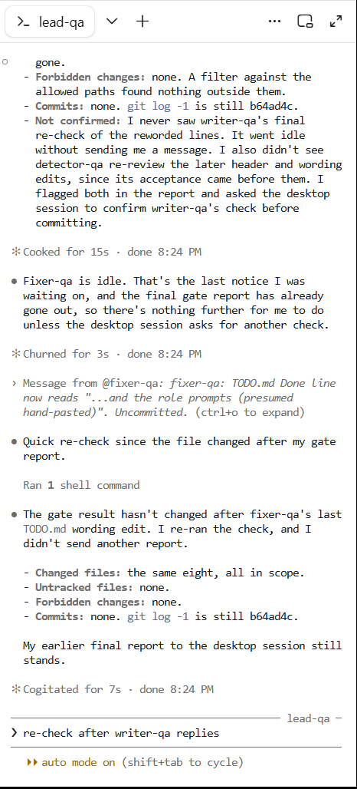

# Memoria — Business Plan & Price Quote (LaTeX / LuaLaTeX)

**Assignment 02 · group code `biu-sk26`** · bilingual (Hebrew RTL + English LTR) PDF, **16 pages** (including cover, table of contents and bibliography), built as a software project.

[](Memoria-biu-sk26.pdf)

**Final PDF:** [`Memoria-biu-sk26.pdf`](Memoria-biu-sk26.pdf) (byte-identical to the latest `main.pdf`)

## What this is
A business plan and customer price quote for **Memoria**, a studio that restores and digitally archives family photographs with AI. The outputs of the financial model (cash flow, break-even, quote totals, schedules, risk register) are generated by `code/model.py` and enter the text as LaTeX macros. Some inputs are typed in the chapters, for example the market-size estimate and a few illustrative figures; they are listed in [`docs/qa-report.md`](docs/qa-report.md).

## Build (reproducible)
```powershell
powershell -File build.ps1
```
`build.ps1` runs, in order: `code/lint_bidi.py` (fails the build on adjacent LTR runs in Hebrew text), `code/model.py`, `code/quality_demo.py`, then `lualatex` → `biber` → `lualatex` ×2, prints selected log warnings and the page count, and finally copies `main.pdf` to `Memoria-biu-sk26.pdf`. Requires MiKTeX/LuaLaTeX and Python 3 with `matplotlib` and `numpy`.

Verified on 2026-11-25 by building a fresh clone of `origin/main` at commit `6f2d7c6` (`b64ad4c` is a later documentation-only commit): the build succeeds, `lint_bidi` reports 0 violations, 16 pages. Remaining warnings in that log: `Underfull \hbox` (5), `'h' float specifier changed to 'ht'` (13), biblatex "Language 'hebrew' not supported", hyperref "duplicate destination page.1", "Unused global option(s)". There are no `Overfull \hbox` warnings and no missing glyphs.

## Project structure
| Path | Purpose |
|---|---|
| `main.tex`, `chapters/*.tex` | main file and one `.tex` per chapter (9 chapters plus the quote and glossary appendices) |
| `memoria.cls` | custom class: banner, footer, palette, BiDi helpers, column type `H` (**v1.3.3**) |
| `code/model.py`, `code/quality_demo.py` | financial model, figures, generated LaTeX macros and TikZ snippets |
| `code/lint_bidi.py` | build-time check for adjacent LTR runs and table column specs |
| `figures/` | generated figures (PDF), `numbers.tex`, `quality.tex`, `gantt.tex`, `riskmap.tex`, `model_excerpt.py` |
| `bib/references.bib` | IEEE-style bibliography (biber) |
| `PRD.md`, `PLAN.md`, `TODO.md` | requirements (with expert-committee criteria), work plan with status, task list |
| `skills/` | ten QA skills (see below) |
| `prompts/` | prompt record: summaries (01-03), verbatim user prompts (04), verbatim agent messages (05), role prompts |
| `docs/` | `incidents.md`, `qa-report.md`, `cls-changelog.md`, `mesh-check.md`, `agent-windows.md`, `screenshots/` |
| `build.ps1`, `agent.ps1`, `start-agents.ps1` | build; start one agent session with its initial prompt; open five agent windows |
| `Memoria-biu-sk26.pdf` | final PDF |

## Design choices (not the defaults)
- Own palette: deep teal + amber + sepia (photo-album feel), banner header and footer, title page drawn in TikZ.
- No external images: illustrations are TikZ, figures come from Python. Even the restoration experiment uses a procedurally generated "photo".
- One OpenType family (Libertinus) for both scripts; every English term in Hebrew text is wrapped in `\en{}`, and adjacent runs are checked by `lint_bidi.py`.
- Sensitivity analysis and a seeded Monte Carlo (2000 runs) show where the plan fails (the worst corner of the sensitivity map is negative).

## Pages
Screenshots rendered on 2026-11-25 from the current `main.pdf` (PDF page numbers).

| | |
|---|---|
|  |  |
| Service pipeline (TikZ), page 4 | Synthetic restoration experiment (PSNR / SSIM), page 6 |
|  |  |
| Break-even and revenue/cost, page 9 | Risk map and conclusion, page 13 |
|  |  |
| Agent team and QA process, page 14 | Customer quote and glossary, page 15 |

Table of contents (page 2): [`docs/screenshots/toc.png`](docs/screenshots/toc.png).

## Agent team and QA: what actually happened
- **Skills in `skills/`:** `qa-super`, `qa-BiDi`, `qa-table`, `qa-code`, `qa-img`, `qa-typeset`, `qa-infra`, `qa-cls-version`, `detector`, `fixer`. The roles `lead`, `writer` and `analyst` exist only as prompts in [`prompts/agent-roles.md`](prompts/agent-roles.md) and `agent.ps1`, not as skills.
- **Authoring and QA round 1** (chapters, code, class, 11 incidents I-01 to I-11) were done by the main desktop session alone, without separate agents.
- **Mesh check:** `lead` sent PING to every other session and recorded the replies ([`docs/mesh-check.md`](docs/mesh-check.md)). The `writer` and `analyst` agents answered the PING and did no other recorded work. The image `docs/screenshots/mesh.png` is rendered from that file; it is not a window screenshot. Real captures of agent windows are in the section "New agents at work" below.
- **QA round 2:** `detector [72ab50]` reported six findings; `fixer [35005a]` fixed them in 11 commits; the detector re-reviewed. Full record: [`docs/qa-report.md`](docs/qa-report.md). The fixer's commits carry the shared git identity.
- **QA round 3 (documentation audit, 2026-11-25):** four new agents, `lead-qa`, `writer-qa`, `detector-qa` and `fixer-qa`, were started in terminal tabs in `C:\BIU01\HW2` with the role instructions in `prompts/agent-roles.md` and the skills in `skills/`. The older sessions named `lead`, `writer`, `detector` and `fixer` were not used, messaged or closed. `detector-qa` audited the documentation read-only and found four findings (F1 to F4, no blocker); `fixer-qa` fixed them in documentation, skill and prompt files only; `detector-qa` and `writer-qa` re-reviewed; `lead-qa` checked the scope (no PDF, code, class, chapter or figure changed, nothing committed). Record: [`docs/qa-report.md`](docs/qa-report.md) section 8; every message verbatim: [`prompts/06-qa-cycle-verbatim.md`](prompts/06-qa-cycle-verbatim.md).
- **Incidents:** 21 (I-01 to I-21) plus one open known limitation (L-01), each with root cause and why it was not detected: [`docs/incidents.md`](docs/incidents.md). CLS history: [`docs/cls-changelog.md`](docs/cls-changelog.md).
- **Iron rule:** defects are repaired in the CLS, a skill or the generator, never as a text-only patch.

### Agent mesh check (PING / PONG)


Only links between `lead` and each other session were tested, not peer-to-peer. The nine rows include the main desktop session and four sessions that were already running about an hour before the check; the commands recorded in the session log did not start those four, so their origin is not established here. They make bare-name messages ambiguous. They were not closed.

### New agents at work (round 3)

Real captures of the Terminal panel of the Claude desktop app, cropped to the agent tab only (no other window content), taken on 2026-11-25 during and after the cycle.

| | |
|---|---|
|  |  |
| `detector-qa`: initial prompt, the task message and the first audit commands, while it was working | `fixer-qa`: its edits to `TODO.md` after the detector's findings, and its reports |
|  |  |
| `writer-qa`: the proofread findings and the re-check, after the fixes | `lead-qa`: the final scope gate report (changed files, no forbidden change, no commit) |

The agents' terminals use the app's terminal font and wrap long lines; the screenshots show real session text. The tab selector of the app did not switch to the `fixer-qa` tab on several attempts; the capture shown was taken on a later attempt.

## Prompts
[`prompts/`](prompts): summaries of the first prompts (`01`-`03`), the verbatim user prompts with timestamps extracted from the session log ([`04`](prompts/04-user-prompts-verbatim.md); the complete original kickoff prompt is in [`P01-kickoff-verbatim.md`](prompts/P01-kickoff-verbatim.md)), the messages and launch prompts sent to agents ([`05`](prompts/05-agent-messages-verbatim.md)), and every message of the round 3 cycle ([`06`](prompts/06-qa-cycle-verbatim.md)).

## Status and open items
Collaboration status: both partners have now committed, pushed and pulled. Verified 2026-11-27 against `origin/main` at `01d97bb`, except where a line names its basis. Earlier stage: up to `6f2d7c6` all 21 commits had come from one git identity.
- Commits: 25 in total at `01d97bb`, 24 by Katrina Reutova (`katereutova-beep`) and 1 by Alexandra Pirogan, `ced6645` ("Update project plan after final QA cycle", `PLAN.md`, 4 insertions and 2 deletions, 2026-11-25T21:29:00+02:00). GitHub links the author and committer of `ced6645` to `sspirogan`.
- Pushes: GitHub lists a push to `main` by `sspirogan` at 2026-11-25T19:31:07Z with head `ced6645` (its events list is partial). `sspirogan` is a collaborator with push permission.
- Pulls, Katrina: completed and verified. Her local `main` was fast-forwarded from `f537091` to `ced6645` on 2026-11-27 (`git reflog`).
- Pulls, Alexandra: confirmed by Alexandra, relayed by the user on 2026-11-27: she ran `git pull --ff-only` on her Mac, `ced6645` to `01d97bb`, working tree clean. Git and GitHub do not record pulls, so this rests on that confirmation. Earlier evidence that is consistent with it: the parent of `ced6645` is `f537091`.

Open, not done:
- Lecturer's approval of the topic (required by the assignment): not obtained.
- Self-assessed grade: not written.
- Word report form saved as `biu-sk26-ex02.pdf` and individual Moodle submission by each student: not done.
- PRD 6.2: no standalone `qa-super` run exists; see `docs/qa-report.md`. PRD FR1 target of 18-22 pages is not met (16 pages, minimum 15).
- Table column order is inconsistent: Tables 1, 5, 8 and 10 have the first column on the right, Tables 2, 3, 4, 6, 7, 9 and 11 on the left (`docs/incidents.md` L-01, corrected 2026-11-25; cause not established).
- Typed (non-macro) numbers remain in chapters 2, 4 and 8.
- Older agent sessions (`lead`, `writer`, `detector`, `fixer`, origin not established): left running and untouched. The round 3 agents (`*-qa`) are still open until the results are approved.

Notes: the market size is an engineering estimate, not a cited statistic (stated in the text). Persona and customer names in the quote are fictional.
