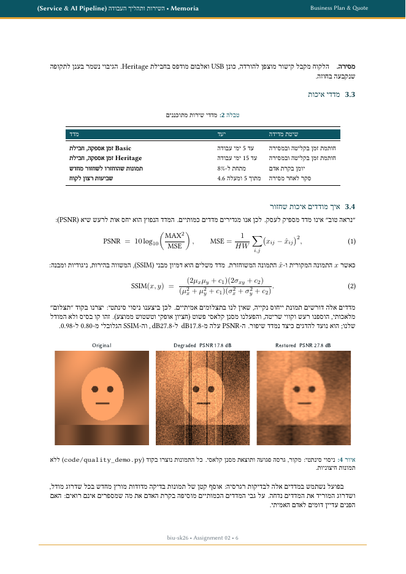
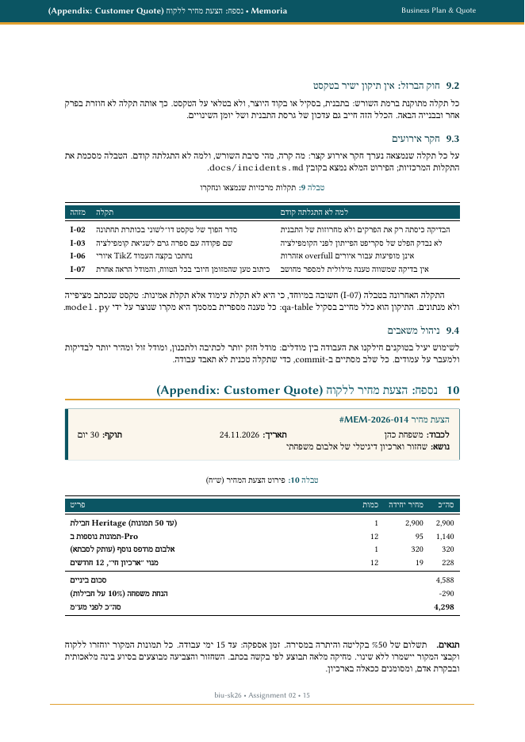

# Memoria — Business Plan & Price Quote (LaTeX / LuaLaTeX)

**Assignment 02 · group code `biu-sk26`** · bilingual (Hebrew RTL + English LTR) PDF, 17 pages, built as a software project.

[](Memoria-biu-sk26.pdf)

**Final PDF:** [`Memoria-biu-sk26.pdf`](Memoria-biu-sk26.pdf)

## What this is
A business plan and customer price quote for **Memoria**, a studio that restores and digitally archives family photographs with AI. Every number in the document is generated by one Python model, so the text cannot drift from the data.

## Build (reproducible)
```powershell
powershell -File build.ps1
```
which runs `python code/model.py`, `python code/quality_demo.py`, then `lualatex` → `biber` → `lualatex` ×2 (requires MiKTeX/LuaLaTeX, Python 3 with `matplotlib` and `numpy`).

## Project structure
| Path | Purpose |
|---|---|
| `main.tex`, `chapters/*.tex` | main file and one `.tex` per chapter |
| `memoria.cls` | custom class: banner, footer, palette, BiDi helpers (v1.2.1) |
| `code/model.py`, `code/quality_demo.py` | financial model, all figures, generated LaTeX macros |
| `figures/` | generated vector figures and `numbers.tex` |
| `bib/references.bib` | IEEE-style bibliography (biber) |
| `PRD.md`, `PLAN.md`, `TODO.md` | expert-committee PRD, work plan, task list |
| `skills/` | QA skills (see below) |
| `prompts/` | numbered prompts and agent role prompts |
| `docs/` | incident log, CLS changelog, screenshots |

## Design choices (not the defaults)
- Own palette: deep teal + amber + sepia (photo-album feel), banner header and footer, title page drawn in TikZ.
- No external images: illustrations are TikZ, figures come from Python. Even the restoration experiment uses a procedurally generated "photo".
- One OpenType family (Libertinus) for both scripts; every English term in Hebrew text is wrapped in `\en{}`.
- Honest numbers: assumptions are labelled; sensitivity analysis and a seeded Monte Carlo (2000 runs) show where the plan fails (worst corner is negative).

## Pages
| | |
|---|---|
|  |  |
| Service pipeline (TikZ) | Synthetic restoration experiment (PSNR / SSIM) |
|  |  |
| Financial forecast and break-even | Risk map and privacy |
|  |  |
| Agent team and QA process | Customer quote appendix |

## Agent team and QA
Roles are defined as Skills: `lead`, `writer`, `analyst`, `detector`, `fixer`, plus the QA family `qa-super`, `qa-BiDi`, `qa-table`, `qa-code`, `qa-img`, `qa-typeset`, `qa-infra`, `qa-cls-version`.

Iron rule: **never fix text directly**. Every defect is repaired in the CLS, a Skill or the generator, the CLS version is bumped, and an incident review records *why it happened* and *why it was not detected*. [`docs/incidents.md`](docs/incidents.md) lists 11 incidents from QA round 1, including one reliability defect (a caption that claimed results the model did not produce). CLS history: [`docs/cls-changelog.md`](docs/cls-changelog.md).

### Skills used
`qa-super` · `qa-BiDi` · `qa-table` · `qa-code` · `qa-img` · `qa-typeset` · `qa-infra` · `qa-cls-version` · `detector` · `fixer` — files in [`skills/`](skills).

## Prompts
The real prompts that steered the agents are in [`prompts/`](prompts): kickoff, decisions, go-ahead/steering and the role prompts.

## Status and honesty notes
- Page count 17 (minimum 15), clean build, no LaTeX warnings except the intentional ones listed in `docs/`.
- Market size is an engineering estimate, not a cited statistic (stated in the text). Persona and customer names in the quote are fictional.
- Self-assessed grade: see `docs/self-assessment.md` (written after the final QA round).
